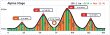
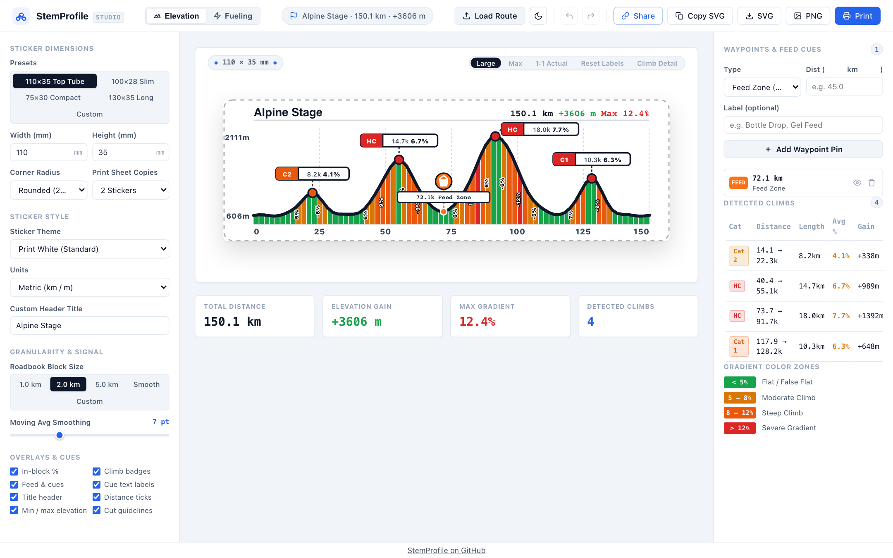
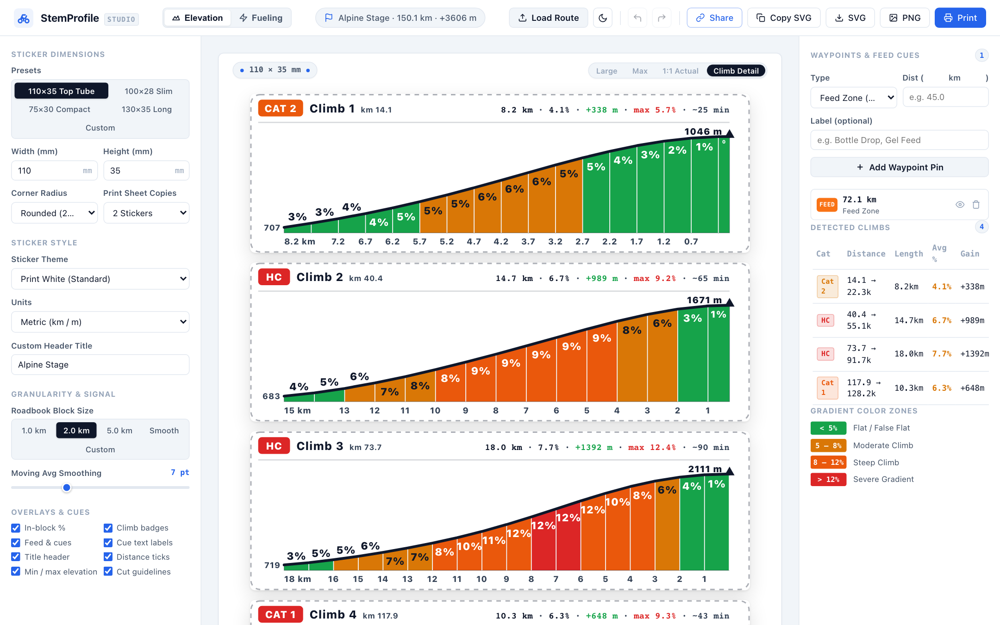
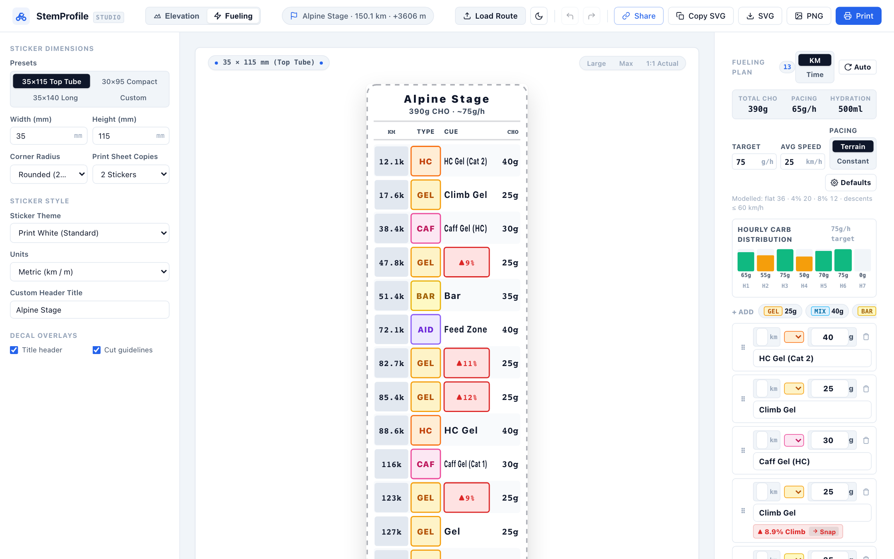
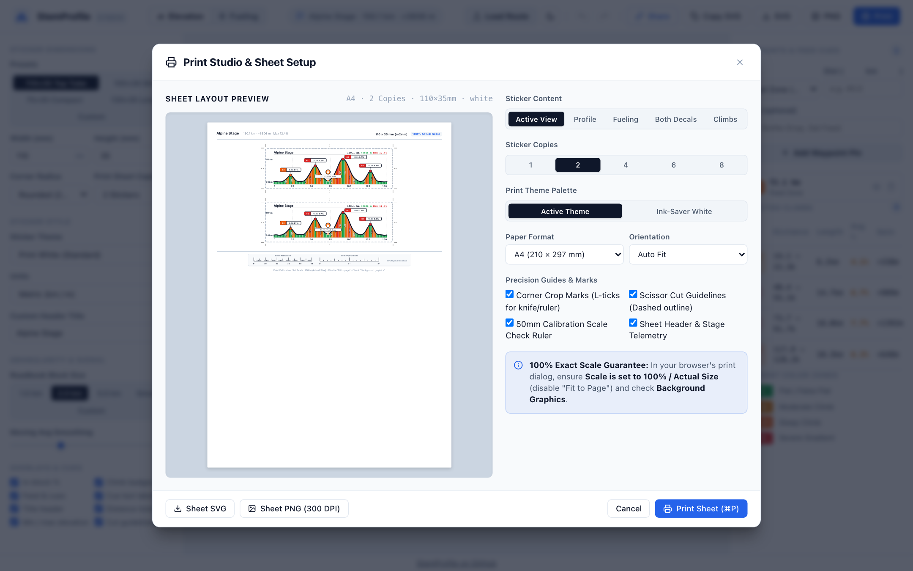
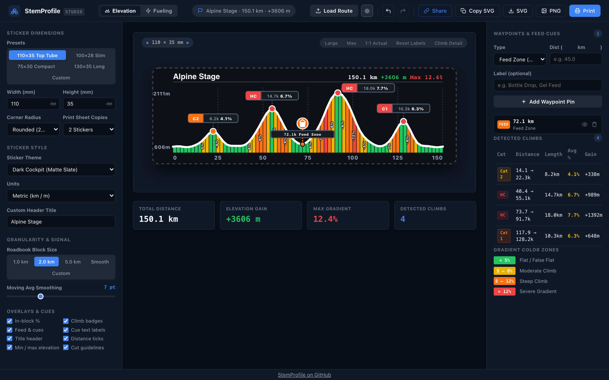

<div align="center">

# StemProfile

**Turn any GPX file into a race-ready elevation sticker for your stem or top tube.**

Free, no sign-up, and your route never leaves your browser.

### [Open StemProfile](https://dwaltsch.github.io/stemprofile/)

[](https://github.com/dwaltsch/stemprofile/actions/workflows/test.yml)
[](LICENSE)



</div>

Your head unit shows the next few hundred meters. A sticker shows the whole day at a glance: how long the climb is, how steep it gets, and where the next bottle is. StemProfile makes one in minutes, in the style of Grand Tour roadbooks, printed at the exact size of your bike.

## See it in action



<table>
  <tr>
    <td width="50%"></td>
    <td width="50%"></td>
  </tr>
  <tr>
    <td align="center"><b>Climb Detail</b>: every climb, block by block</td>
    <td align="center"><b>Fueling</b>: when to eat, marked by kilometer</td>
  </tr>
  <tr>
    <td></td>
    <td></td>
  </tr>
  <tr>
    <td align="center"><b>Print Studio</b>: true-size sheets with crop marks</td>
    <td align="center"><b>Dark mode</b>: with matching sticker themes</td>
  </tr>
</table>

## How it works

1. **Drop in your route.** GPX, TCX and FIT files all work, so exports from Strava, Komoot, Garmin and RideWithGPS are fine.
2. **Fit it to your bike.** Pick a preset such as `110 × 35 mm` for a top tube, or enter your own size.
3. **Add your race plan.** Click the profile to place feed zones, bottles, sprints and hazards.
4. **Print it.** Print to scale on sticker paper with crop marks, or export a file for a print shop.

## Features

**Reads like a roadbook**
- Gradient-colored blocks of 2.5 km, 1 km, 500 m or any custom length, with the percentage inside each one
- Climbs detected and categorized automatically, from Cat 4 to HC
- Badges that move out of each other's way on busy mountain stages
- Climb Detail stickers: one zoomed sticker per climb, with segment gradients and distance to the summit

**Plans your race**
- Cues for feeds, water, gels, sprints, summits, hazards, tech support and checkpoints, picked up automatically from waypoints in your file
- A fueling plan with carb and fluid targets, plus a separate cue sheet sticker
- Timing from a cycling power model, so cues account for going slower uphill

**Prints at true size**
- Print Studio with A4 / US Letter sheets, 1 to 8 copies, crop marks and a 50 mm scale ruler to check your printer
- SVG for plotters and vinyl cutters, 300 DPI PNG for label printers
- Six sticker themes, metric or imperial units

**Stays out of your way**
- Share links carry the elevation profile, your cues and settings, but no GPS positions
- Undo and redo for every edit
- Nothing to install: it runs in any modern browser

## Privacy

StemProfile runs entirely in your browser. There is no backend, account or analytics, and your route files are never uploaded.

## Run it locally

There are no dependencies and no build step:

```bash
git clone https://github.com/dwaltsch/stemprofile.git
cd stemprofile
python3 -m http.server 8000
```

Then open `http://localhost:8000`.

## Contributing

Bug reports, ideas and pull requests are welcome. Start with [CONTRIBUTING.md](CONTRIBUTING.md), and see [docs/architecture.md](docs/architecture.md) for the signal processing, climb formulas and project structure. To report a vulnerability, see [SECURITY.md](SECURITY.md).

## License

[MIT](LICENSE)
